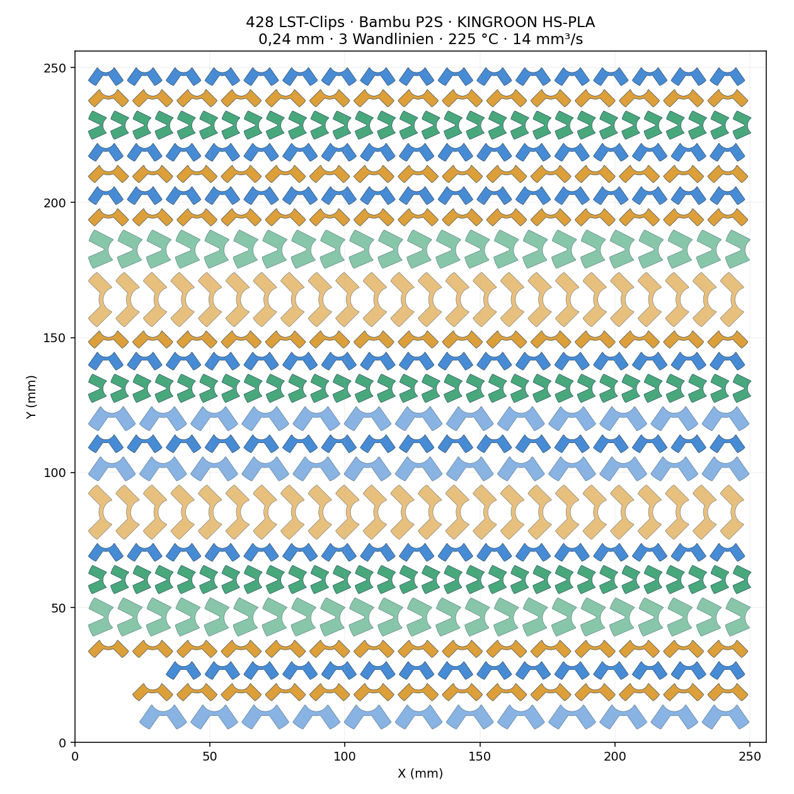

# LST-Clips für Bambu P2S und KINGROON HS-PLA

Eine Druckplatte mit **428 Clips**, drei Winkeln und zwei Öffnungsgrößen (ungefähr 3,83 und 5,18 mm).

- [Volle Druckplatte herunterladen](LST_428_P2S_KINGROON_HS_PLA.3mf)
- [Passprobe mit sechs Clips](LST_Passprobe_6_P2S_KINGROON_HS_PLA.3mf)
- [Komplettes Druckpaket als ZIP](P2S_KINGROON_LST_Druckpaket.zip)
- [Analyse und Druckhinweise](Druckhinweise_P2S_HS_PLA.md)

**Profil:** P2S, 0,4-mm-Standarddüse, Textured PEI, KINGROON HS-PLA schwarz, 0,24-mm-Schichten, drei Wandlinien. Geschätzt 5 h 32 min und 72 g PLA. Erfolgreich in Bambu Studio 2.08.02.61 gesliced; kein physischer Probeausdruck bestätigt. Vor der vollen Platte die Passprobe drucken und die tatsächliche Hardware sowie das Materialprofil kontrollieren.

Original-Designer und Lizenzinformationen sind in den 3MF-Dateien erhalten. Die ursprüngliche Datei nennt MDKaiser und „MakerWorld Exclusive License“; eine neue Lizenz oder Freigabe für die enthaltenen Modelle wird hier nicht erteilt.

