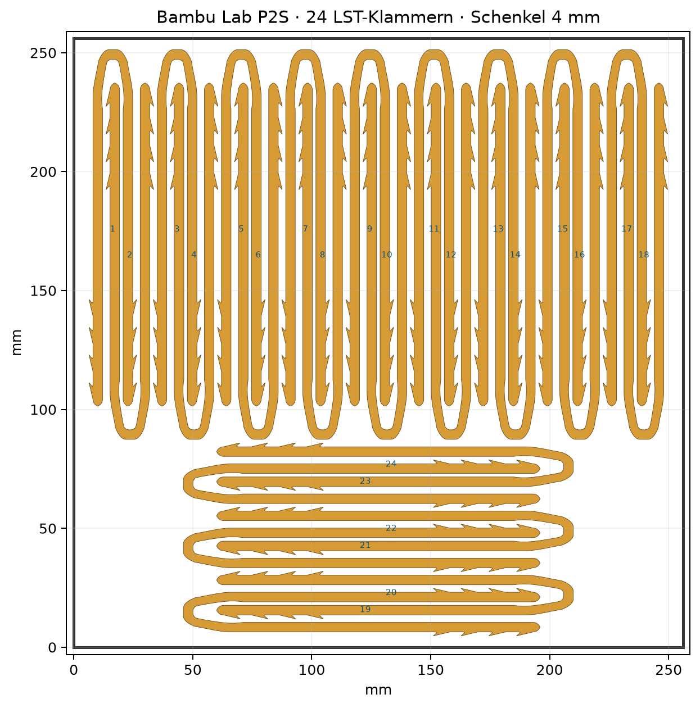

# 3D Files

3D-Druckmodelle und Druckplatten.

## LST-Klammer: verstärkte Schenkel, Bambu Lab P2S

- [3MF: Druckplatte mit 24 Klammern](LST-Klammer/LST-Klammer-P2S-24x-4mm.3mf)
- [STL: Einzelteil](LST-Klammer/LST-Klammer-4mm.stl)
- [ZIP: alle Druckdateien und Vorschau](LST-Klammer/LST-Klammer-Download.zip)
- [Prüfbericht](LST-Klammer/Pruefbericht.json)

Beide geraden Schenkel wurden von ca. 1,33 auf 4 mm verstärkt. Außenmaße: 20 × 149,83 × 4 mm. Innere Öffnung der geraden Schenkel: ca. 8,67 mm. Die Zähne und Außenmaße bleiben erhalten; die Verstärkung liegt innen und geht in den bestehenden Bogen über.

24 Teile auf einer 256 × 256 mm P2S-Platte, mindestens 1,49 mm Teileabstand und 4,76 mm Randabstand. Das vorhandene P2S-Profil mit 0,4-mm-Düse, 0,2-mm-Schichthöhe und Filamentplatz 2 (Generic PLA Silk) wurde übernommen. Brim, Skirt und Reinigungsturm sind deaktiviert; Druck nach Schichten.

Geschlossene, konsistent orientierte Geometrie, Manifold-Status, Abstände und 3MF-Import wurden geprüft. Ein Slicer-Lauf oder realer Druck wurde nicht durchgeführt. Vor dem Druck in Bambu Studio slicen und die Schichtvorschau prüfen.

### Herkunft

Remix des Modells **LST helper (low stress training for plants)** von **extrawitz**, aus der vom Nutzer bereitgestellten Datei `LST-Klammer.3mf`. Das ursprüngliche 3MF nennt die Lizenz **Standard Digital File License**. Es wird keine zusätzliche Lizenz für das Originalmodell erteilt; die ursprünglichen Lizenzbedingungen gelten weiterhin. Die ursprünglichen Designer- und Lizenzangaben bleiben im 3MF erhalten.
